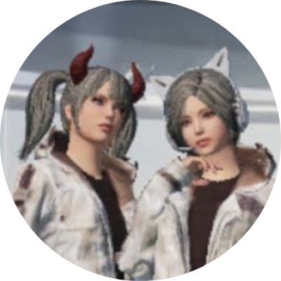

<a href="README.md">
  
</a>
<a href="README-TR.md">
  
</a>

  <br />
  <br />

<div align="center">
  
  <br />
  <br />

  <p>
     PUBG dönemimden kalan anıları saklayan küçük bir web sitesi.
  </p>


  <p>
    <a href="#demo">Demo</a> •
    <a href="#about">Hakkında</a> •
    <a href="#features">Özellikler</a> •
    <a href="#tech">Teknolojiler</a> •
    <a href="#setup">Kurulum</a> •
    <a href="#license">Lisans</a>
  </p>

  <br />
  <br />
</div>

## <a id="demo"></a> 📷 Demo

- [https://xkintaro.github.io/memories-pm/](https://xkintaro.github.io/memories-pm/)

## <a id="about"></a> 📋 Hakkında

**Memories PM**, ilk projelerimden biridir. HTML ve CSS öğrenirken, PUBG'de arkadaşlarımla biriktirdiğim anıları saklamak için hazırladım. Bir anı ve arşiv olarak burada tutuyorum.

## <a id="features"></a> ✨ Özellikler

- **Hatıralar**: Arkadaşlarımla oynadığım oyunlardan ekran görüntülerini gösteren bir sayfa.
- **Hakkımda**: PUBG kimliğimin yer aldığı kısa bir sayfa.
- **Sosyal bağlantılar**: Ana sayfada Discord, Instagram ve TikTok hesaplarım.

## <a id="tech"></a> 🛠️ Teknolojiler

`HTML` · `CSS`

## <a id="setup"></a> 🚀 Kurulum

### Adım Adım Kurulum

1. **Depoyu klonlayın**

   ```bash
   git clone https://github.com/xkintaro/memories-pm.git
   cd memories-pm
   ```

2. **Siteyi açın**

   `index.html` dosyasını tarayıcınızda açın.

## <a id="license"></a> 📄 Lisans

Bu proje MIT Lisansı altında lisanslanmıştır. Detaylar için [LICENSE](LICENSE) dosyasına bakabilirsiniz.

#

<p align="center">
  <sub>❤️ Developed by "Mustafa TAŞAL" (kintaro)</sub>
</p>
